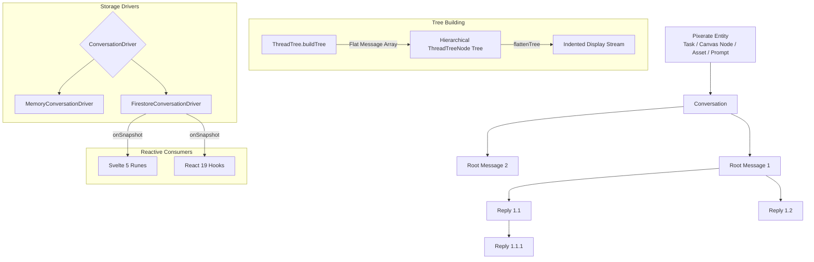

# Architecture & Design: `@pixerate/conversations`

`@pixerate/conversations` is a layered, UI-agnostic library designed to manage discussions, comment threads, and multi-user annotations across any Pixerate entity.

---

## 1. System Topology



---

## 2. Core Concepts & Data Models

### Entity Attachment (`EntityRef`)
Conversations are decoupled from specific business objects by attaching polymorphically to an `EntityRef`:
```typescript
interface EntityRef {
  id: string;
  type: 'task' | 'canvas_node' | 'asset' | 'document' | 'generation' | string;
  title?: string;
  projectId?: string;
  metadata?: Record<string, unknown>;
}
```

### Conversation Thread (`Conversation`)
The conversation envelope tracks lifecycle state and aggregated metadata:
- `id`: Unique identifier (e.g., `convo_task_123` or autogenerated).
- `entity`: Target entity reference.
- `status`: `'open'` | `'resolved'` | `'archived'`.
- `participantIds`: List of user/agent IDs involved in the thread.
- `messageCount`: Total comments in the thread.
- `lastMessageAt`: ISO timestamp of the latest comment.

### Message (`Message`)
Individual comments within a conversation:
- `id`: Unique message ID.
- `conversationId`: Reference to parent conversation.
- `author`: `NotificationActor` (`id`, `name`, `email`, `avatarUrl`, `type`).
- `content`: Plain-text content.
- `richContent`: Optional HTML formatted by `@pixerate/editor`.
- `parentId`: Optional ID of parent message for nested replies.
- `mentions`: Array of user or agent IDs mentioned in the message.
- `attachments`: File or asset references.
- `status`: `'sent'` | `'pending'` | `'failed'` | `'deleted'`.

---

## 3. Resilience & Edge Cases

### Cycle Detection
If a message's parent lineage forms a closed loop (`A -> B -> A`), `ThreadTree.buildTree` detects visited nodes, breaks the cycle safely, and mounts the cyclic node at the root with a warning flag.

### Orphan Recovery
If a parent comment is deleted or missing from the current query slice, replies are not dropped. `ThreadTree` synthesizes a placeholder parent (`isDeleted: true`) or groups them under the nearest valid ancestor.

### Subcollection Scaling
Firestore messages are organized into subcollections:
`conversations/{id}/messages/{messageId}`.
Summary fields (`messageCount`, `lastMessageAt`) are maintained on the parent document using Firestore atomic increments, keeping entity queries fast and cost-effective.
