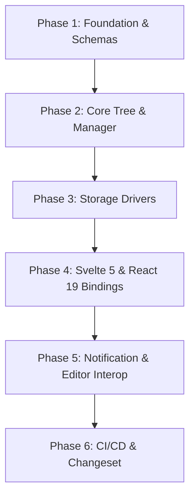

# Implementation Plan: `@pixerate/conversations` & Mention Integration

This document outlines the architecture, roadmap, and delivery steps for `@pixerate/conversations`.

---

## 1. Overview & Goals

`@pixerate/conversations` is a UI-agnostic, headless library providing conversation and comment-thread management across any Pixerate entity (tasks, canvas nodes, video generations, storyboards, prompt templates).

### Success Criteria:
1. **Headless & UI-Agnostic Core**: Zero dependencies on React or Svelte in core logic. Swappable storage drivers (`MemoryConversationDriver` for tests, `FirestoreConversationDriver` for production).
2. **First-Class Framework Bindings**: Svelte 5 runes (`$state`, `$derived`) and React 19 hooks (`useSyncExternalStore`).
3. **Resilient Thread Tree Algorithms**: Safe parent-child hierarchy building, cycle detection, orphan recovery, and linear flattening.
4. **Clean Integration with Ecosystem**:
   - Consumes schemas from `@pixerate/schemas` (`NotificationActor`, `EntityRef`, `Message`, `Conversation`).
   - Receives structured rich text and mention nodes from `@pixerate/editor`.
   - Emits live typing indicators and sync events via `@pixerate/realtime`.
   - Triggers downstream mention parsing and multi-channel delivery via `@pixerate/notifications`.

---

## 2. Package Architecture

```
@pixerate/conversations/
├── src/
│   ├── lib/
│   │   ├── index.ts              # Main entrypoint
│   │   ├── types.ts              # Zod schemas & TypeScript definitions
│   │   ├── server.ts             # Server entrypoint
│   │   ├── svelte.ts             # Svelte 5 runes
│   │   ├── react.ts              # React 19 hooks
│   │   ├── gcp.ts                # Firestore driver
│   │   ├── core/
│   │   │   ├── ConversationManager.ts
│   │   │   ├── ThreadTree.ts
│   │   │   ├── transcript.ts
│   │   │   └── mentionTokens.ts
│   │   ├── drivers/
│   │   │   ├── ConversationDriver.ts
│   │   │   ├── MemoryConversationDriver.ts
│   │   │   └── FirestoreConversationDriver.ts
│   │   ├── svelte/
│   │   │   └── thread.svelte.ts
│   │   └── react/
│   │       └── useThread.ts
│   └── __tests__/
├── docs/
│   ├── ARCHITECTURE.md
│   └── PLAN.md
├── AGENTS.md
├── GOTCHAS.md
├── README.md
└── package.json
```

---

## 3. Phased Implementation Roadmap



### Phase 1: Foundation & Schemas
- Define Zod models in `src/lib/types.ts`:
  - `EntityRefSchema`: polymorphic targets (`task`, `canvas_node`, `asset`, `document`, `generation`).
  - `MessageSchema`: rich author, structured content, parentId, status, attachments.
  - `ConversationSchema`: thread status (`open`, `resolved`, `archived`), participant lists, message counters.
  - `ThreadTreeNode`: recursive tree node structure.

### Phase 2: Core Tree & Manager
- **`ThreadTree`**:
  - `buildThreadTree(messages, options)`: transforms flat arrays into trees with depth tracking and cycle protection.
  - `flattenTree(nodes)`: converts trees into display order for linear feeds.
  - `countDescendants(node)`: calculates total reply counts per comment.
- **`ConversationManager`**:
  - Thread lifecycle: `createConversation`, `resolveConversation`, `reopenConversation`.
  - Message actions: `postMessage`, `editMessage`, `deleteMessage`.
  - Optimistic updates with rollback support.
- **`transcript`**:
  - `formatThreadAsMarkdown(thread)`: exports discussions for LLM agent context, summaries, or audit logs.
- **`mentionTokens`**:
  - Fast extraction of `<span data-type="mention" data-id="...">` tokens from rich text.

### Phase 3: Storage Drivers
- `ConversationDriver` interface: CRUD + reactive subscriptions (`subscribeToConversation`, `subscribeToEntityConversations`).
- `MemoryConversationDriver`: In-memory implementation with event emitter for deterministic unit testing.
- `FirestoreConversationDriver`: Firestore document collections (`conversations/{id}`) and subcollections (`conversations/{id}/messages/{id}`).

### Phase 4: Svelte 5 & React 19 Bindings
- **Svelte 5 Runes (`src/lib/svelte/thread.svelte.ts`)**:
  - `createThreadStore(driver, conversationId)`: exposes `$state` for `conversation`, `messages`, `tree`, and `$derived` counts.
- **React 19 Hooks (`src/lib/react/useThread.ts`)**:
  - `useThread(driver, conversationId)`: uses `useSyncExternalStore` for SSR-safe, flicker-free reactive updates.

### Phase 5: Notification & Editor Interop
- In `@pixerate/notifications`:
  - Scope mention notification IDs: `mention_${commentId}_${recipientId}`.
  - Clean HTML snippet stripping for preview bodies.
  - Shield code blocks and URLs from regex matching.
  - Add `resolveRecipients` for server-side fan-out.

### Phase 6: CI/CD & Verification
- GitHub Actions workflow running on Node 24.
- `sv check` (`npm run check`) and unit test coverage (`npm run test`).
- Changeset workflow and Dependabot configured for weekly updates.
